  

  &nbsp;
  &nbsp;
  &nbsp;
  

## `> whoami`

**Backend Software Engineer** with 3 years of experience building scalable **Java and Spring Boot microservices**, event-driven systems on **Apache Kafka**, and cloud services on **AWS** — with a focus on low latency and reliability.

Senior Software Engineer at **Compro Technologies**, where I led a DynamoDB and S3 migration of 10M+ objects end to end, cut lookup latency from 800ms to under 20ms, and mentor newer engineers. Competitive programmer on the side: **Global Rank 51** in LeetCode Weekly 472 and **All India Rank 6** in CodeChef's Long Challenge.

I'm looking for high-impact backend roles on systems built for scale.

## 💼 Experience

### Senior Software Engineer · Compro Technologies
Jul 2023 – Present

- Led a **DynamoDB and S3 migration** end to end, moving **10M+ objects** through an idempotent pipeline; redesigned indexes cut lookup latency from **800ms to under 20ms** and read cost by **40%**.
- Architected a **Kafka event pipeline** that decoupled 4 downstream services and improved data freshness by **30%**.
- Designed **JWT authentication and role-based access control** across 6+ microservices with Redis-cached permission checks **under 10ms**; passed a third-party security audit with **zero critical findings**.
- Moved CI/CD to **GitHub Actions** with ECS rolling deploys, cutting hotfix releases from **4 hours to under 1 hour**.
- Raised test coverage from **under 30% to 87%** with JUnit 5 and Mockito, cutting production bugs by **40%**.
- Partnered daily with product managers and QA to deliver REST APIs and transactional workflows for a subscription-based assignment platform, growing feature adoption by **20% in two quarters**.
- Mentored and onboarded **3 junior engineers**, presented system designs in team reviews, and ran root-cause analysis on production issues using New Relic.

## 🚀 Projects

<h3 align="center">🧠 LLM Gateway</h3>

  

  

- Implemented an **API gateway over Anthropic, OpenAI, Groq and AWS Bedrock** that routes each request to the **cheapest capable model**, with **confidence-based escalation** and **cross-provider fallback**.
- Exposed **OpenAI-compatible streaming endpoints** with tool calling, per-key rate limits and daily budget caps.

  
  
  
  

<h3 align="center">⚡ Distributed Rate Limiter</h3>

  

  

- Open-sourced **Token Bucket** and **Sliding Window** limiters using **Redis Lua scripts**: **12,000 req/sec, p99 under 5ms**.
- Created a **Spring AOP `@RateLimit`** annotation for per-user, per-IP and per-key limits, with **circuit-breaker fallback**.

  
  
  

<h3 align="center">🔔 Notification Engine</h3>

  

  

- Engineered a **50,000+ notifications/hour** engine on **priority-tiered Kafka topics** with **Redis deduplication**, exponential backoff and **dead-letter queues** for duplicate-free delivery.
- Modeled a **delivery state machine** on MySQL with Redis caching, serving real-time status reads in **under 50ms**.

  
  
  
  
  

<b>More projects</b>

 

| Project | Description | Stack |
|---------|-------------|-------|
| [Smart Contact Manager](https://github.com/the-evolver/smart_contact_manager) | Contact management with Spring Security, CSRF protection and MVC | Java, Spring Boot, Hibernate |
| [AirBnBee](https://github.com/the-evolver/AirBnBee) | Full-stack accommodation platform with SSR and OAuth | Next.js, React, MongoDB, Prisma |

## 🛠️ Technical Skills

  

<b>Engineering:</b> System Design · Distributed Systems · Event-Driven Architecture · Design Patterns · Agile

## 🏆 Achievements

  

  Verify: <a href="https://leetcode.com/contest/weekly-contest-472/ranking/2/?region=global_v2">LeetCode Weekly 472 ranking</a> ·
  <a href="https://www.codechef.com/rankings/OCT221C">CodeChef Long Challenge ranking</a> ·
  <a href="https://leetcode.com/u/recursive_coder/">LeetCode profile</a>

## 📊 Stats

  
  

  

Rendered from live data by this repo's own GitHub Action — refreshed daily.

## 🎓 Education

**Bachelor of Technology, Computer Science and Engineering** · CGPA **9.2 / 10** 
JK Institute of Applied Physics and Technology, University of Allahabad · Jul 2019 – Jun 2023

